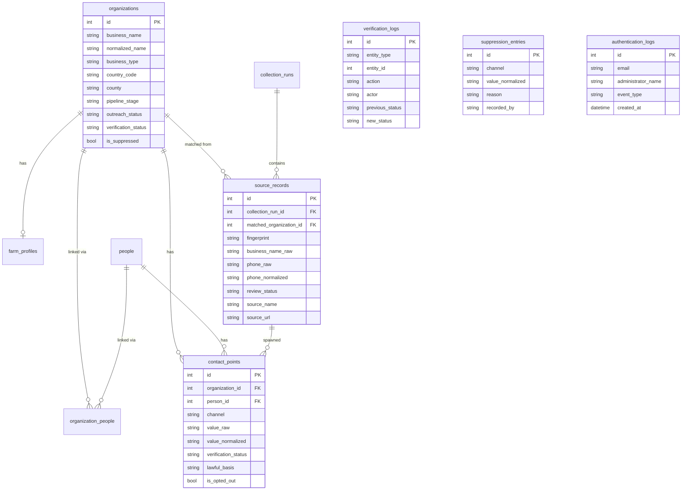
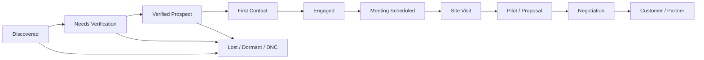

# FishOps Prospecting & Relationship Intelligence System
### Kenya Aquaculture Value Chain · Phases 1–3 · Architecture Reference

> [!IMPORTANT]
> **All scraped records are UNVERIFIED until manually reviewed.**
> Never mark a scraped contact as verified automatically.
> Never overwrite a manually verified value with an unverified scrape.

---

## Workspace Layout

```
fishops-database/
├── fishops/
│   ├── __init__.py
│   ├── config.py          # Settings, env vars, folder creation
│   ├── auth.py            # Google OIDC administrator allowlist
│   ├── constants.py       # Business types, pipeline stages, 47 KE counties
│   ├── normalization.py   # Phone, email, name, URL, county, classification
│   ├── staging.py         # CandidateRecord → DB (org shell + source record + contacts)
│   ├── collectors/
│   │   ├── base.py        # CandidateRecord dataclass, BaseCollector, CSV export
│   │   ├── goafrica.py    # Go Africa Online (52+ KE aquaculture listings)
│   │   ├── kefs.py        # Kenya Fisheries Service FAQs + hatchery register
│   │   ├── osm_overpass.py # OpenStreetMap Overpass API (mapped farms)
│   │   ├── wikidata.py    # Wikidata SPARQL (structured public data)
│   │   └── csv_import.py  # Load any external CSV / register spreadsheet
│   └── db/
│       ├── models.py      # SQLAlchemy ORM: all 10 tables
│       └── session.py     # Engine factory, init_db, session_scope context manager
├── migrations/            # Alembic PostgreSQL schema migrations
├── scripts/
│   ├── migrate_sqlite_to_postgres.py
│   └── verify_migration.py
├── tests/
│   ├── test_normalization.py  # 34 unit tests
│   └── test_staging.py        # 7 database tests
├── collect.py             # CLI: multi-source collector + DB staging
├── app.py                 # Streamlit dashboard (4 pages)
├── requirements.txt
└── pyproject.toml
```

---

## Database Schema



> [!NOTE]
> `organizations` and `people` are always separate records.
> A farm can have multiple contacts; a person can be linked to multiple businesses.
> `suppression_entries` is the Kenya DPA / ODPC opt-out ledger.

---

## Pipeline Stages



---

## Collection Sources (Kenya v1)

| Source | Adapter key | Priority | Value chain coverage |
|--------|-------------|----------|----------------------|
| Kenya Fisheries Service FAQs | `kefs` | Very High | Hatcheries, certified farms |
| KEFS Authenticated Hatchery Register | `kefs` | Very High | Registered aquaculture establishments |
| Go Africa Online | `goafrica` | High | Full value chain (52+ listings) |
| OpenStreetMap Overpass API | `osm` | Supplementary | Mapped farms and facilities |
| Wikidata SPARQL | `wikidata` | Supplementary | Structured public business data |
| CSV Import | `--import-csv` | Manual | Any external spreadsheet or register |

**Business types classified:** fish_farm · hatchery · feed_manufacturer · processor · distributor · input_supplier · cooperative · research_training · regulator_association · other · unknown

---

## Normalization & Deduplication Rules

| Rule | Detail |
|------|--------|
| Phone normalization | `07xx` / `01xx` / `254xx` / `+254xx` → E.164 `+254xxxxxxxxx` |
| Email normalization | Lowercase + strip |
| Name comparison key | Strip Ltd/Limited/Co/Group, collapse whitespace, `&` → `and` |
| Deduplication fingerprint | SHA-256 of `country_code\|normalized_name\|phone_normalized_or_url` |
| County inference | Exact match on 47 official names, then major-town → county map |
| Classification | 8-rule keyword match, ordered from specific to broad; confidence = low/medium |
| Raw values preserved | `phone_raw`, `email_raw`, `business_name_raw` are never overwritten |

---

## Commands

```bash
# Collect from all sources and stage into the configured database
python collect.py --sources goafrica kefs osm wikidata --max-pages 5 --delay 3

# Collect only, skip DB (review CSV first)
python collect.py --sources goafrica --max-pages 3 --dry-run

# Import a manual register CSV
python collect.py --import-csv kefs_hatchery_list.csv --source-name "KEFS Manual Export"

# Launch Streamlit dashboard
streamlit run app.py

# Run tests
python -m pytest tests/ -v
```

---

## Environment Variables

| Variable | Default | Purpose |
|----------|---------|---------|
| `FISHOPS_DATABASE_URL` | `sqlite:///data/fishops.db` | Switch to PostgreSQL: `postgresql+psycopg2://...` |
| `FISHOPS_DATA_DIR` | `./data` | Root for DB and CSV output |
| `FISHOPS_RAW_DIR` | `./data/raw` | CSV export directory |
| `FISHOPS_DEFAULT_COUNTRY` | `KE` | ISO-3166 country code |
| `FISHOPS_ADMIN_EMAIL_1` | — | Google account authorized for Tracy Wambui Mburu |
| `FISHOPS_ADMIN_EMAIL_2` | — | Google account authorized for Stanley Gathekia |

Production uses Supabase PostgreSQL in the isolated `prospects` schema. Set
`FISHOPS_DATABASE_URL` in the environment or `[database].url` in Streamlit
secrets. Do not put database credentials in source files.

## Administrator Access

The Streamlit app uses Google OpenID Connect through Streamlit's native
`st.login()` / `st.user` / `st.logout()` flow. Access is granted only when the
authenticated email exactly matches one of the normalized administrator emails.
The configured administrator names are display labels, not authorization
identifiers. The allowlist is configured using `FISHOPS_ADMIN_EMAIL_1` and
`FISHOPS_ADMIN_EMAIL_2`, or `[admins].email_1` and `[admins].email_2` in
Streamlit secrets.

Authentication events (successful login, denied access, and logout) are stored
in `prospects.authentication_logs`. Authorized administrators can see recent
events and the last successful login in the sidebar. No OIDC tokens are stored.
Copy `.streamlit/secrets.toml.example` to `.streamlit/secrets.toml` for local
configuration; never commit the populated secrets file.

## PostgreSQL Migrations

Apply the schema migration with `python -m alembic upgrade head`. The current
migration creates the authentication audit table; `init_schema.py` remains the
idempotent ORM bootstrap for the existing CRM tables. To transfer an existing
SQLite database, set `FISHOPS_DATABASE_URL` to Supabase PostgreSQL and run:

```powershell
python scripts/migrate_sqlite_to_postgres.py --sqlite-path data\fishops.db
python scripts/verify_migration.py --sqlite-path data\fishops.db
```

The transfer leaves SQLite untouched, preserves IDs, and is repeatable for
identical destination records. A conflicting row with the same primary key
stops the transaction rather than being silently skipped.

## Collection Operations

Collect a reviewed source set with `python collect.py --sources <keys>`.
Available keys are `goafrica`, `kefs`, `osm`, and `wikidata`. Use `--dry-run`
first to generate a review CSV without database writes; only remove that flag
after inspecting the result. `--delay` is clamped to the configured minimum.
Do not disable TLS verification or robots checks to work around an endpoint
failure.

When staged, every distinct candidate creates a provenance-bearing source
record. Explicit source phone, email, and website values are copied to contact
points with `verification_status=unverified` and `lawful_basis=unknown`.
Missing contact details are not generated. Repeated fingerprints are skipped;
matching organizations are linked without replacing verified information.
See the dated [source collection report](source-collection-report-2026-11-25.md)
for actual results and failures from the latest run.

---

## Data Quality & Compliance Checklist

> [!CAUTION]
> Kenya Data Protection Act and ODPC regulations apply. Contact data collected
> from public directories is not automatically available for direct marketing.

- [x] Raw source values preserved and never overwritten by scraped data
- [x] `verification_status = "unverified"` on every incoming record
- [x] `review_required = True` on every CandidateRecord
- [x] `is_opted_out` and `opted_out_at` fields on every ContactPoint
- [x] `suppression_entries` table with normalized value lookup
- [x] `lawful_basis` field on every ContactPoint (default: `unknown`)
- [x] `verification_logs` immutable audit trail for status changes
- [x] `source_url` and `collected_at` retained on every SourceRecord
- [x] robots.txt respected before every web request
- [x] Minimum 2-second delay between HTTP requests enforced at base level
- [ ] **Phase 4:** Full review UI with approve / merge / reject / opt-out workflow
- [x] **Phase 7:** Google OIDC allowlist and authentication audit implementation
- [ ] **Phase 7:** Live OAuth validation and encrypted backups

---

## Implementation Phases

| Phase | Deliverable | Status |
|-------|-------------|--------|
| 1 | Multi-source Python collector + CSV export | ✅ Done |
| 2 | SQLite DB, deduplication, staging, verification schema | ✅ Done |
| 3 | Streamlit directory, overview, review queue, collection log | ✅ Done |
| 4 | Contacts, calls, WhatsApp conversations, interaction timeline | 🔲 Next |
| 5 | Meetings, site visits, tasks, follow-up reminders | 🔲 Planned |
| 6 | Pipeline Kanban, geographic map, analytics | 🔲 Planned |
| 7 | PostgreSQL migration, authentication, backups, deployment | 🟡 Partial: PostgreSQL and auth implemented; live OAuth/deployment/backups pending |
